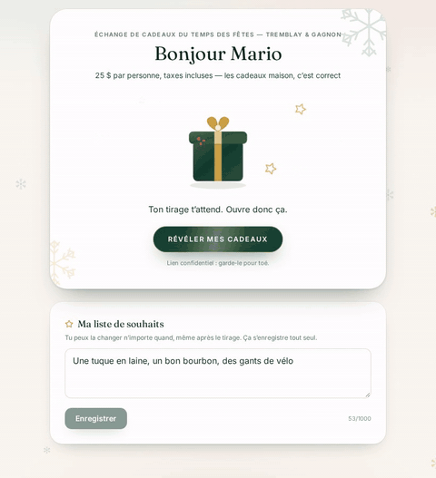
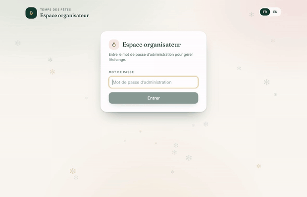
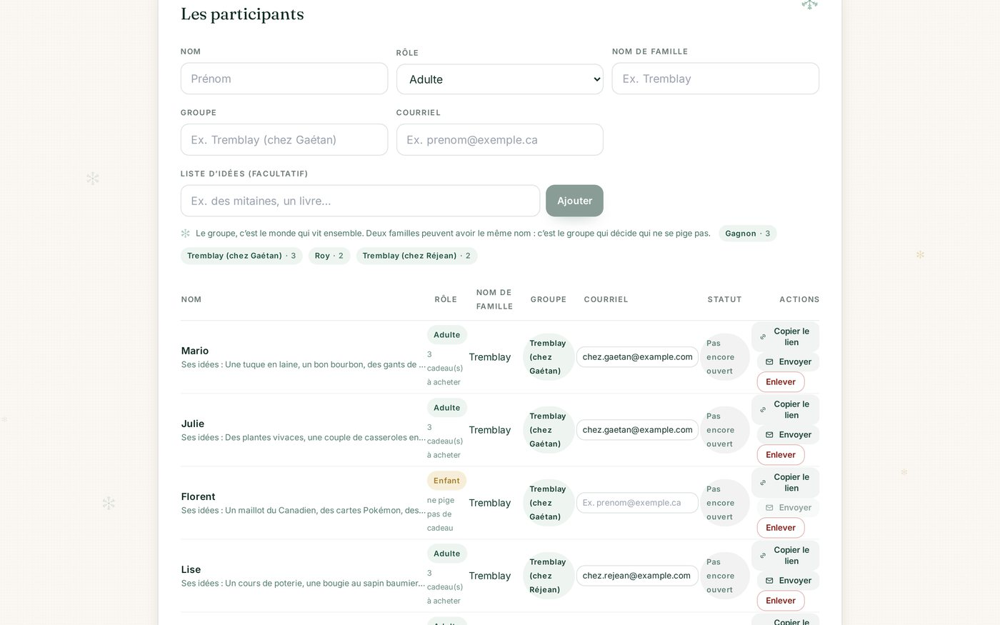
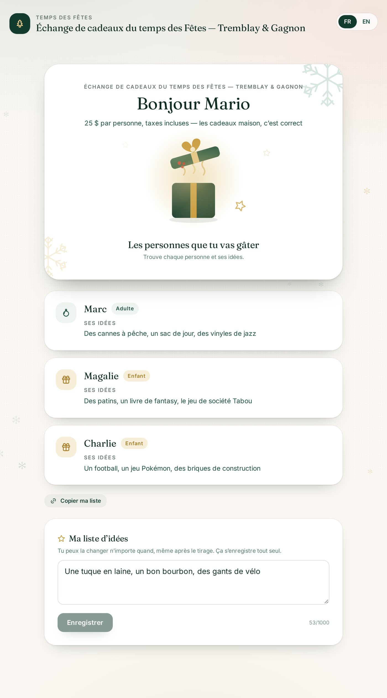
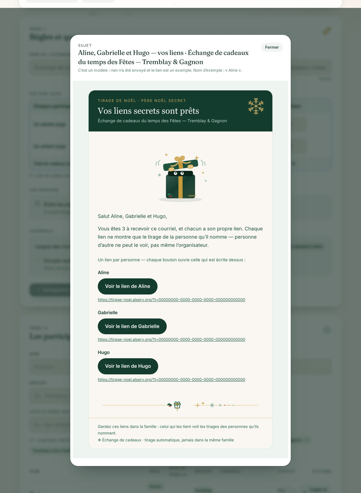
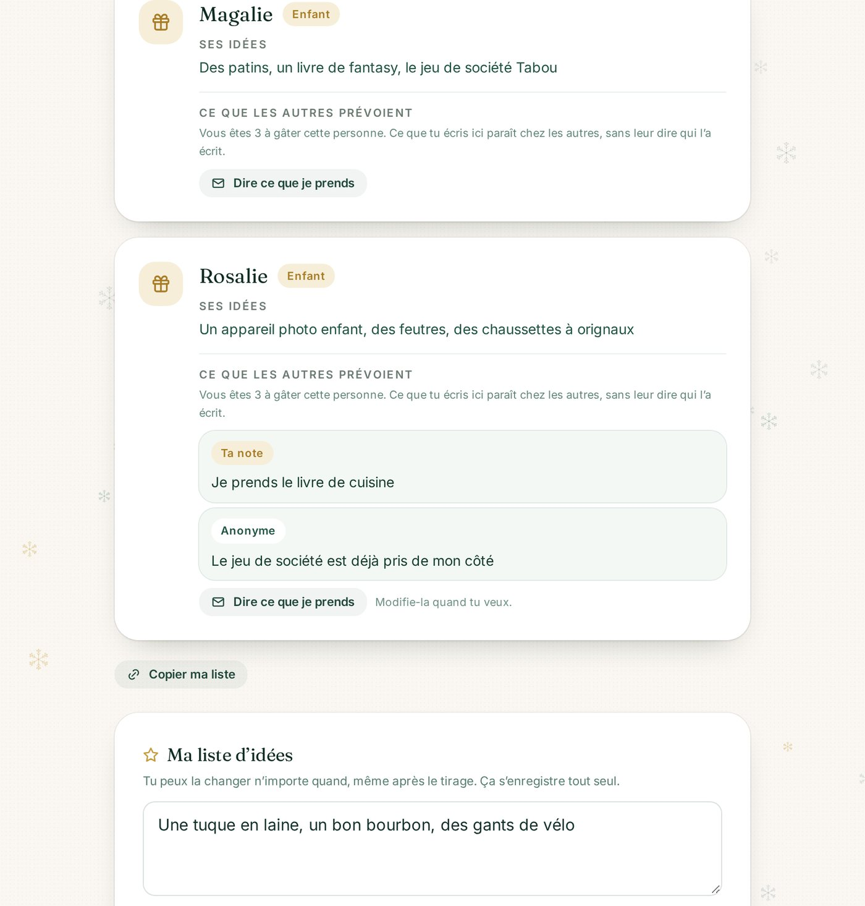

# Family Gift Exchange

Self-hosted Secret Santa for a big family: role-based draw quotas (adult / child), soft household grouping, one private link per person, and an organizer console that **never sees the pairings**.

FastAPI + SQLite · zero-build SPA (Tailwind CDN + Alpine.js) · **Québec French (`fr-CA`, default) and English (`en-CA`)** · amounts in CAD.

| The gift-box reveal | Organizer flow |
|---|---|
|  |  |

---

## Quick start

```bash
git clone https://github.com/alecc08/gift-exchange.git
cd gift-exchange
cp .env.example .env
```

Set `ADMIN_PASSWORD` and `SESSION_SECRET` in `.env`:

```bash
openssl rand -base64 18    # -> ADMIN_PASSWORD
openssl rand -hex 32       # -> SESSION_SECRET
```

Then start the container:

```bash
# LAN / local testing (publishes 8085 on all interfaces):
docker compose up -d

# Production behind a TLS reverse proxy (127.0.0.1:8085, read-only root FS, uid 1000):
mkdir -p data && chown -R 1000:1000 data
docker compose -f docker-compose.hardened.yml up -d
```

Prebuilt images are published to `ghcr.io/alecc08/gift-exchange:latest` (or pin a commit SHA).

Open **`http://localhost:8085/admin`** to sign in, configure rules, add participants, and lock the draw. The root path `/` serves a family landing page with no admin link.

To load fictional demo data first:

```bash
ADMIN_PASSWORD=<your password> python3 tools/seed_demo.py --draw
```

### Without Docker

```bash
bash run_tests.sh
ADMIN_PASSWORD=<pw> SESSION_SECRET=<hex> \
  .venv/bin/uvicorn main:app --host 127.0.0.1 --port 8085 --no-access-log
```

### Backups

`data/exchange.db` holds all wishlists and private link tokens — keep backups private (`chmod 600`):

```bash
docker compose stop
cp -a data "/backups/santa-$(date +%F)" && chmod -R 600 "/backups/santa-$(date +%F)"
docker compose start
```

---

## Screenshots

<table>
  <tr>
    <td width="50%"><br><b>Roster &amp; households</b> — group chips, per-person gift counts, and per-household send buttons.</td>
    <td width="50%"><br><b>Participant reveal</b> — who you buy for, their wishlist, and autosaving wishlist editor.</td>
  </tr>
  <tr>
    <td width="50%"><br><b>Household email</b> — one email per mailbox with labelled links for each person at that address.</td>
    <td width="50%"><br><b>Co-giver notes</b> — anonymous coordination notes when multiple givers draw the same person.</td>
  </tr>
</table>

---

## Key features

- **Multiple draws**: Run separate exchanges (family, office, cousins) on one instance, or copy an existing roster into a new draw with fresh tokens.
- **Quotas & household grouping**: Set adult/child draw quotas (`0..10`). `family_group` is a display surname; `group_key` is the household unit. If zero same-group crossings is impossible, the solver relaxes by the minimum crossings required and reports only the count.
- **Safe live edits**: Once a draw is locked, quotas and group rules are frozen, while `event_title`, `budget_note`, `email_language`, and participant email addresses can still be updated. `POST /api/admin/reset` clears pairings if you need to re-draw.
- **Participant experience**: Private `/?t=<uuid>` links, gift-box reveal animation (respects `prefers-reduced-motion`), autosaving wishlists, and anonymous co-giver notes when `co_givers > 1` (hidden from both the recipient and the admin).
- **Email delivery (Resend)**: Optional. Bundles participants sharing an email address into one household message, supports empty-wishlist reminder emails, and previews templates before sending.
- **Bilingual (FR-CA / EN-CA)**: Complete UI parity (**246 keys each**, tested in `tests/test_i18n.py`) plus a separate `email_language` setting per draw.

---

## Configuration

| Variable | Default | Purpose |
|---|---|---|
| `ADMIN_PASSWORD` | `admin` (required in hardened) | Organizer password. Blank value disables `/admin` (`503`). |
| `SESSION_SECRET` | derived (required in hardened) | HMAC-SHA256 signing key for 12h admin session tokens. |
| `ADMIN_PATH` | `/admin` | Path where the organizer console is served. |
| `TRUST_PROXY` | `0` | Set to `1` only behind a reverse proxy so `X-Forwarded-For` / `X-Forwarded-Proto` are trusted. |
| `PUBLIC_BASE_URL` | unset | Public origin used for links and images in emails (required if sending from behind a local host). |
| `DB_PATH` | `data/exchange.db` | SQLite database path. |
| `RESEND_API_KEY` | unset | Enables email sending via Resend when set. |
| `RESEND_FROM` | unset | Verified sender address (e.g. `Santa <santa@example.com>`). |
| `LOGIN_RATE_LIMIT` / `LOGIN_LOCKOUT_THRESHOLD` / `LOGIN_LOCKOUT_SECONDS` | `10` / `5` / `300` | Admin login rate limiting and lockout. |
| `DRAW_RATE_LIMIT` / `API_RATE_LIMIT` / `EMAIL_RATE_LIMIT` | `120` / `300` / `60` | Per-minute IP/organizer rate limits. |

See [`.env.example`](.env.example) for the full list of tuning variables.

---

## Security notes

- Terminate TLS at a reverse proxy (Caddy/Traefik/nginx) with `TRUST_PROXY=1`; participant URLs contain bearer-equivalent UUIDv4 tokens.
- No admin endpoint ever returns pairings or co-giver notes.
- API logs redact UUID tokens (`<token>`) and omit page routes; `/docs`, `/redoc`, and `/openapi.json` are disabled.
- Rate limits live in process memory and reset on restart; data at rest in `data/exchange.db` is unencrypted.

Full threat model and specification: [`PLAN.md`](PLAN.md).

---

## Development & tests

```bash
bash run_tests.sh                                      # full pytest suite
ADMIN_PASSWORD=<pw> python3 tools/verify_acceptance.py # end-to-end check against a live instance
```

```
gift-exchange/
├── main.py                     # FastAPI app, SQLite schema/migrations, draw solver, emailer
├── static/index.html           # Single-file Alpine.js + Tailwind SPA (landing, participant, admin)
├── tests/                      # Pytest suite (engine, API, security, i18n, emails, notes, docs)
├── tools/                      # Demo seeding, acceptance check, art & media generators
├── docker-compose.yml          # Standard compose (all interfaces, port 8085)
└── docker-compose.hardened.yml # Hardened compose (127.0.0.1:8085, read-only FS, uid 1000)
```

---

## License

MIT — see [`LICENSE`](LICENSE) and [`NOTICE`](NOTICE).
