# Family Gift Exchange · Échange de cadeaux

Configurable Secret Santa for a big family: role-based draw quotas (adult / child), a group rule
that keeps a household out of its own draw, one private link per person, and an organizer who
**never sees the pairings**.

FastAPI + SQLite · single-page frontend (Tailwind CDN + Alpine.js, no build step) · UI in
**Québec French** (`fr-CA`) with a one-click EN switch · amounts in Canadian dollars.

| The gift-box reveal | Unlock → snowfall → copy every link |
|---|---|
| 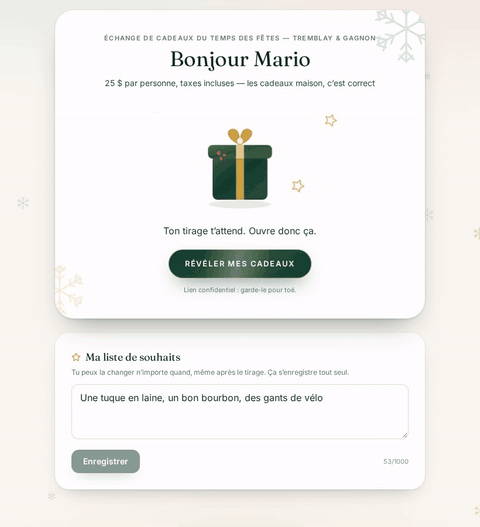 | 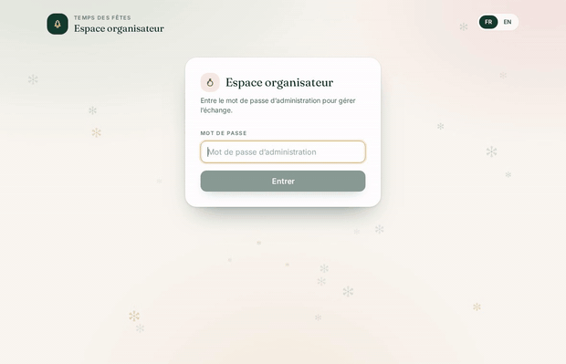 |

---

## Deploy

You need Docker. That's it.

```bash
git clone https://github.com/alecc08/gift-exchange.git
cd gift-exchange
cp .env.example .env
nano .env                  # set ADMIN_PASSWORD and SESSION_SECRET (see below)
docker compose up -d       # builds the image, starts on http://127.0.0.1:8085
```

Two values in `.env` actually matter. Generate them and paste the output in:

```bash
openssl rand -base64 18    # -> ADMIN_PASSWORD   (long passphrase = the organizer key)
openssl rand -hex 32       # -> SESSION_SECRET   (signs the admin session tokens)
```

Then open **http://localhost:8085**, sign in, and:

1. **Panel 1** — event title, budget note (« 25 $ par personne, taxes incluses »), who draws what,
   and whether picks inside the same group should be avoided.
2. **Panel 2** — add the family: name, adult/child, family name, and the **group** (the household the
   rule actually works on — see [Grouping](#grouping-a-family-name-is-not-a-household)). Hit
   **Copier tous les liens** to put every private link on the clipboard.
3. **Panel 3** — **Lancer le tirage**. Everyone gets their own link; nobody, not even
   you, sees the pairings.
4. Each person opens their link, unwraps the gift, and can edit their wishlist at any time —
   it saves itself.

Want to look around before adding real people?

```bash
ADMIN_PASSWORD=<your password> python3 tools/seed_demo.py --draw   # fictional Quebec family
```

**To reach the family on your Wi-Fi**, use the default file (publishes on all interfaces):
`docker compose up -d`, then give everyone `http://<this-machine's-LAN-IP>:8085`.
**To put it behind a domain with HTTPS**, use the hardened file and a proxy — next section.

**Already have Docker and no interest in building?** CI publishes the same image on every push to
`main`, so one line of the compose file is enough — replace `build: .` with a pinned tag
(`.github/workflows/build.yml` is the whole recipe, and the package is public):

```yaml
    image: ghcr.io/alecc08/gift-exchange:<full git sha>     # :latest also exists; pin the sha
```

### Which compose file?

| | `docker-compose.yml` | `docker-compose.hardened.yml` |
|---|---|---|
| Port | `8085:8000` on every interface | `127.0.0.1:8085:8000` only (proxy must front it) |
| Container user | root (image default) | uid `1000`, unprivileged |
| Root filesystem | writable | **read-only**, `/tmp` on tmpfs |
| Linux capabilities | default | **all dropped**, `no-new-privileges` |
| `SESSION_SECRET` | optional (derived) | **required** — refuses to start without it |
| `ADMIN_PASSWORD` | defaults to `admin` | **required** — refuses to start unset |
| Extras | — | memory/CPU/pid caps, log rotation |

```bash
mkdir -p data && chown -R 1000:1000 data      # one-time, only for the hardened file
docker compose -f docker-compose.hardened.yml up -d
```

### HTTPS behind a reverse proxy (what you want for a real event)

The app deliberately does not terminate TLS. Put a proxy in front and set `TRUST_PROXY=1`.

Caddy (automatic Let's Encrypt):

```caddy
santa.example.com {
    reverse_proxy 127.0.0.1:8085
}
```

Traefik (add to the service in `docker-compose.hardened.yml`):

```yaml
    labels:
      - traefik.enable=true
      - traefik.http.routers.santa.rule=Host(`santa.example.com`)
      - traefik.http.routers.santa.entrypoints=websecure
      - traefik.http.routers.santa.tls.certresolver=letsencrypt
      - traefik.http.services.santa.loadbalancer.server.port=8000
```

### No Docker?

```bash
bash run_tests.sh                      # creates .venv, installs deps, runs the suite
ADMIN_PASSWORD=<pw> SESSION_SECRET=<hex> \
  .venv/bin/uvicorn main:app --host 127.0.0.1 --port 8085
```

### Backups (do one — and keep it private)

`data/` holds every wishlist **and** every participant's private link token, so whoever can read a
backup can open anybody's gifts. Encrypt it, `chmod 600` it.

```bash
docker compose stop
cp -a data "/backups/santa-$(date +%F)" && chmod -R 600 "/backups/santa-$(date +%F)"
docker compose start          # hardened file: docker compose -f docker-compose.hardened.yml start
```

One row of damage control: `POST /api/admin/reset` wipes the pairings and the opened-markers and
reopens editing; participant links stay valid. If you need the links themselves to stop working,
delete and re-add the participant.

---

## Security hardening guidelines

### Do these before you send a single link

1. **Set a real `ADMIN_PASSWORD`.** The spec default `admin` is refused by the hardened compose
   file, and while it is in use the container logs a warning and the organizer console shows a
   yellow banner (« Le mot de passe d'administration est encore celui de départ… »). If you see
   that banner, you are not ready to send links. A **blank** value (an unset `${VAR}` in a
   compose file) shuts the console entirely: every login and admin call answers `503`.
2. **Set `SESSION_SECRET`.** Without it the signing key is derived from the password, so every
   password change invalidates live sessions (and any token you might have leaked across deploys
   keeps a predictable derivation). `openssl rand -hex 32`.
3. **Terminate TLS at a proxy** (Caddy/Traefik/nginx) and never expose `8085` straight to the
   internet — participant links carry a bearer-equivalent UUID in the query string.
4. **Set `TRUST_PROXY=1` only behind your own proxy.** It is what makes `X-Forwarded-For` count
   for rate limiting and logs; with the app directly exposed, a client could spoof that header and
   buy itself a fresh budget.
5. **Publish the port on localhost** when a proxy fronts it (`docker-compose.hardened.yml` does
   this) so nothing bypasses TLS.
6. **Protect `data/`**: it is the whole state (names, wishlists, tokens). Keep it out of git
   (already git-ignored), `chmod 600` backups, full-disk encryption on the host.
7. **Back up once before the event** (command above). Restoring is `cp` it back and restart.
8. **Update the image periodically** (`docker compose build --pull && docker compose up -d`) so
   the base Python image stays patched; the app itself pins `fastapi==0.115.0` / `uvicorn==0.30.6`
   on purpose.
9. **Distribute the links like keys**: privately (one message per person), never in a public group
   post or printed on the invitation; a link is enough to see that person's gifts.
10. **Watch the log** while links are live — `docker compose logs -f`. Every security-relevant
    event is one line, with no secrets in it:

    ```
    INFO gift-exchange login_failed ip=24.114.27.9
    INFO gift-exchange login_lockout ip=24.114.27.9 seconds=300
    INFO gift-exchange request ip=24.114.27.9 method=GET path=/api/limits status=200 ms=1.3
    INFO gift-exchange draw_locked ip=… assignments=18
    ```

### Already enforced by the code (nothing to configure)

| Control | Behaviour |
|---|---|
| Password guessing | Per-IP fixed-window limit on `POST /api/admin/login` → `429` + `Retry-After`, and a temporary lockout after repeated failures; constant-time comparison. |
| Misconfigured secret | A **blank** `ADMIN_PASSWORD` (the usual result of an unset `${SECRET}` expanding in a compose file) is not treated as a password: the organizer console answers `503` to every login and every admin request, `/api/limits` reports `default_password: true`, the console shows the banner and the log says so. It can never authenticate `""`. |
| Token guessing | `GET /api/draw/{token}` has its own per-IP budget; tokens are UUIDv4; unknown tokens are an indistinguishable `404`. |
| Volume / payload abuse | Shared per-IP budget for the rest, and a request-body cap → `413`. |
| Password on every request | Login also returns a short-lived **HMAC-SHA256 session token** (12 h) usable as `Authorization: Bearer`; `POST /api/admin/logout` revokes it server-side; the SPA stores the token, never the password. |
| Injection / XSS | Zero-build frontend, no `innerHTML` of user data; CSP pins the CDNs (`script-src`, `base-uri 'self'`, `form-action 'none'`, `frame-ancestors 'none'`, `object-src 'none'`), `X-Content-Type-Options: nosniff`, `X-Frame-Options: DENY`. |
| Private-link leakage | `Referrer-Policy: no-referrer` + `<meta name="referrer" content="no-referrer">`, so `/?t=<uuid>` never rides out in a Referer. |
| Unbounded input | Pydantic length caps on every text field (name 80, family name 60, group 60, wishlist 1000, title 120, budget 500); the SPA mirrors them via `GET /api/limits`. |
| Torn writes | Draws and resets are serialised by a process lock inside one SQLite transaction; a rejected draw writes nothing. |
| Accidental re-draw | `POST /api/admin/draw` on a locked event → `409` (« already locked, reset first ») instead of silently invalidating links people already opened. |
| Organizer blindness | No admin route ever reads the `assignments` table — the console physically cannot show pairings. |
| Debug noise vs leaks | One line per request (`request ip=… method=… path=… status=… ms=…`) plus auth/draw/reset/link events, with IP, status and latency; error bodies are the fixed `detail` strings, never stack traces; `/docs`, `/redoc` and `/openapi.json` are disabled. The image starts uvicorn with `--no-access-log` so the app's own X-Forwarded-For-aware line is the single record. |

### Tuning knobs

| Env var | Default | Purpose |
|---|---|---|
| `ADMIN_PASSWORD` | `admin` (hardened file: required) | Organizer password. |
| `SESSION_SECRET` | derived (hardened file: required) | HMAC key for session tokens. |
| `TRUST_PROXY` | `0` | Trust `X-Forwarded-For` only behind your own proxy. |
| `LOGIN_RATE_LIMIT` | `10` | Login attempts per minute per client. |
| `LOGIN_LOCKOUT_THRESHOLD` / `LOGIN_LOCKOUT_SECONDS` | `5` / `300` | Failed logins before a temporary lockout, and its length. |
| `DRAW_RATE_LIMIT` / `API_RATE_LIMIT` | `120` / `300` | Per-minute budgets for participant links / everything else. |
| `MAX_BODY_BYTES` | `16384` | Request body cap → `413`. |
| `SESSION_TTL_SECONDS` | `43200` | Admin session lifetime. |

### What this app does *not* protect against

* **Anyone who can read a link** can see that person's gifts — the token *is* the credential, and
  there is no second factor, no email verification, no account system.
* Browser history, a shared phone, a printed link, a forwarded message.
* **Data at rest is not encrypted.** Whoever can read `data/exchange.db` reads everything.
* Long-lived brute-force blocking: the limiter lives in process memory and **resets on restart**.
  For a public deployment, add proxy-level protections (Caddy/Traefik rate limiting, fail2ban,
  IP allowlisting on `/api/admin`).
* It is built for one family event on infrastructure you control, not as a multi-tenant service.

Full threat/control write-up: [`PLAN.md`](PLAN.md#security-hardening-addendum).

### Pre-flight check (before sending the links)

```bash
curl -s localhost:8085/api/health                       # {"status":"ok"}
curl -s localhost:8085/api/limits | grep default_password
#   "default_password": false   <-- must be false
ADMIN_PASSWORD=<pw> python3 tools/verify_acceptance.py  # ends with: ACCEPTANCE: PASS
```

---

## The organizer console

<table>
  <tr>
    <td width="50%">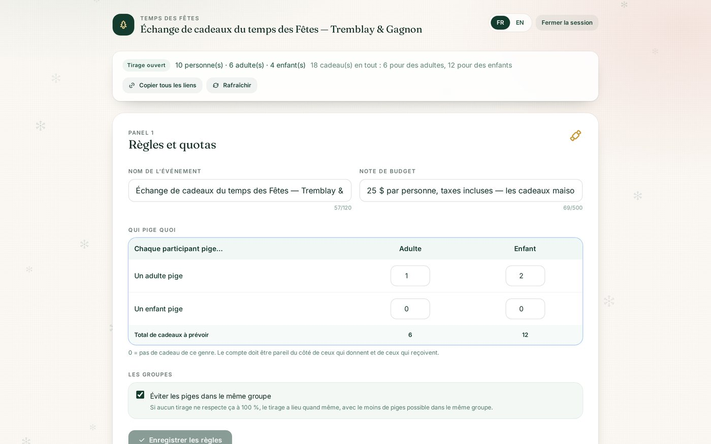<br><b>Rules &amp; quotas</b> — live gift totals, character counters, and a warning while the admin password is still the default.</td>
    <td width="50%">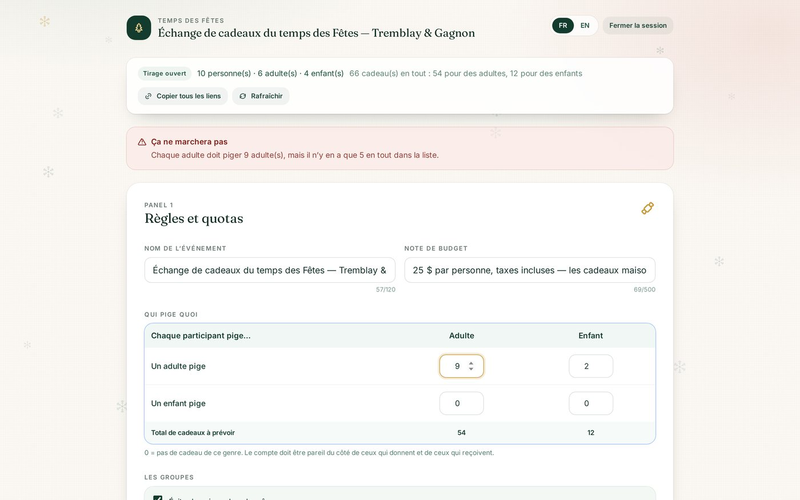<br><b>Feasibility warnings</b> — the quota arithmetic is checked while you type, so an impossible draw is explained instead of failing after a click.</td>
  </tr>
  <tr>
    <td>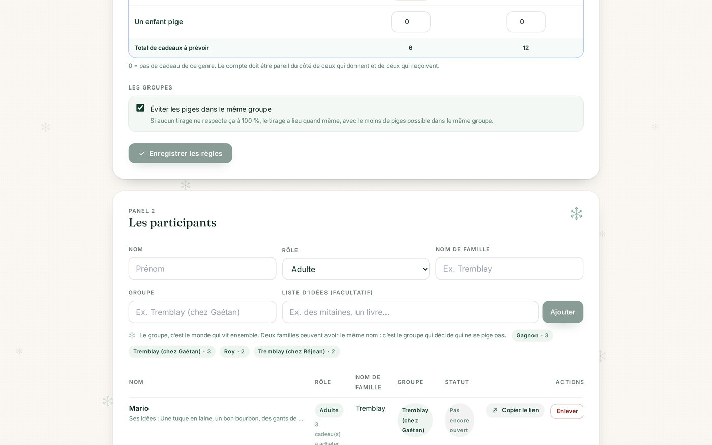<br><b>Roster</b> — per-person gift count, a column for the surname and one for the group, chips with counts, wishlist preview.</td>
    <td>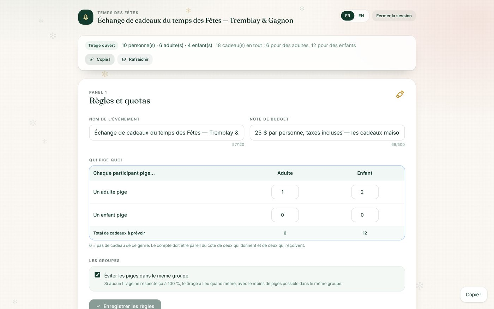<br><b>Copy all links</b> — one click, one toast; each row keeps its own copy state.</td>
  </tr>
  <tr>
    <td>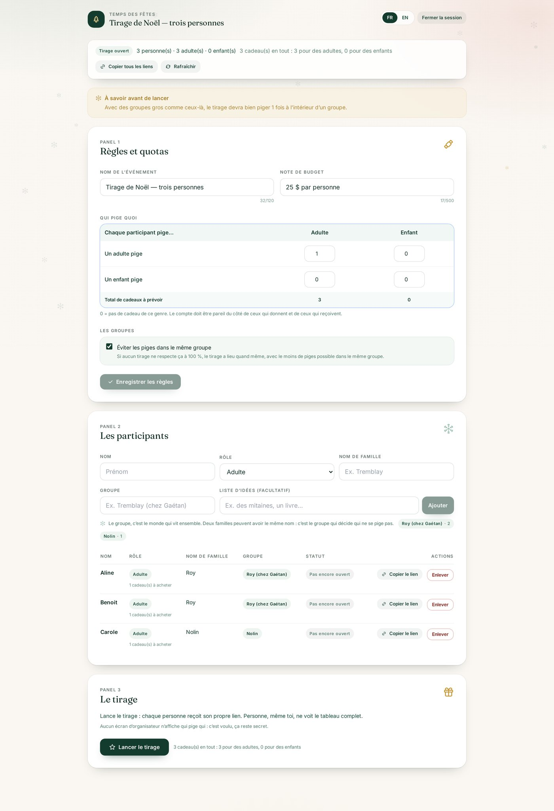<br><b>The console thinks ahead</b> — this roster cannot respect the group rule; the note says how many picks it will cost, and the draw button stays enabled.</td>
    <td>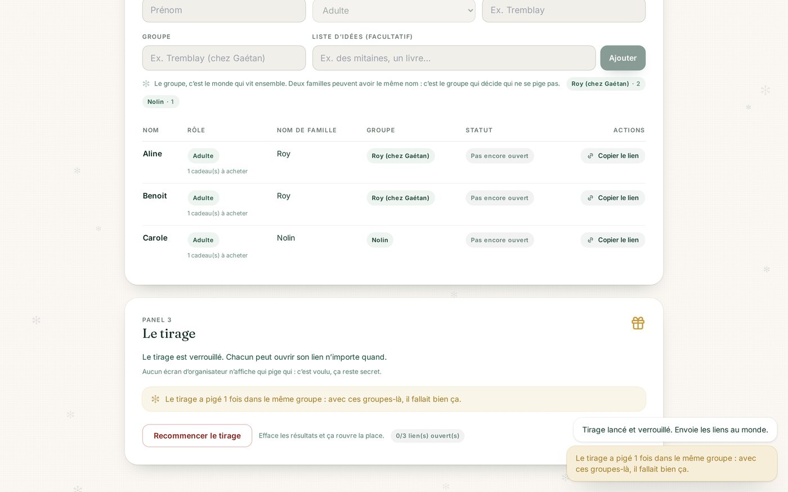<br><b>…and admits what it did</b> — the draw ran, with exactly the one crossing the arithmetic forced. A count, never a pairing.</td>
  </tr>
  <tr>
    <td>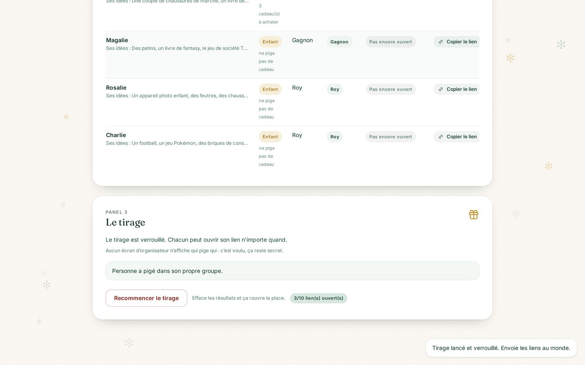<br><b>Locked draw</b> — counts how many links were opened; re-drawing a locked event is refused until you reset.</td>
    <td>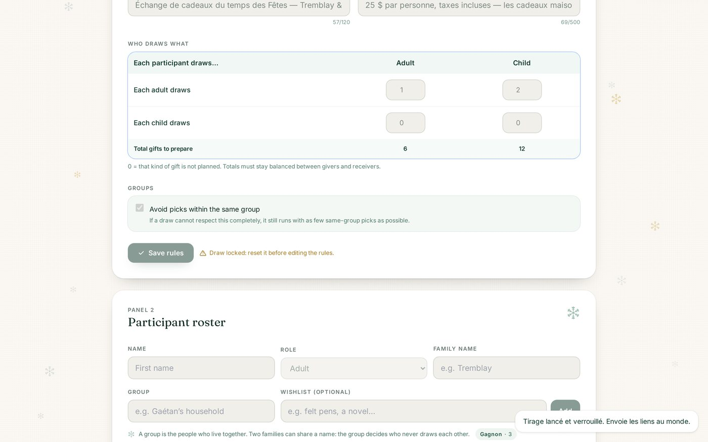<br><b>One-click FR ⇄ EN</b> — every string exists in both languages, remembered per browser.</td>
  </tr>
</table>

### Grouping: a family name is not a household

A big family has two different things people call "la famille": the **surname**, and the **household
the rule is about**. Cousins can carry the same surname as you and live in a different house, and two
surnames can share one roof. So the participant record carries both:

| Field | Label | What it does |
|---|---|---|
| `family_group` | « Nom de famille » | A label for the roster. Never used by the engine. |
| `group_key` | « Groupe » | The unit of the rule. Two people with the same group_key are one household. |

An empty `group_key` means *in no group* — and two empties are **not** one group: each one becomes a
private key (`#solo:<id>` internally), so someone with nothing filled in can be drawn by anyone
except themselves.

The rule is a **preference, not an axiom** (Panel 1: « Éviter les piges dans le même groupe »):

* The solver first tries a draw with **zero** same-group picks. Most rosters finish there.
* If none exists, it does **not** answer `422`. It computes a lower bound on how many gifts *must*
  cross (`_min_crossings()`), then tries that budget, then one more, until a draw exists — so the
  relaxation is as small as the arithmetic allows. A 2-person household in a 3-person roster draws,
  with exactly one crossing.
* The console says so, in both directions: before the draw the note predicts it (« le tirage devra
  bien piger 1 fois à l'intérieur d'un groupe »), after the draw the panel reports the number
  (« Le tirage a pigé 1 fois dans le même groupe : avec ces groupes-là, il fallait bien ça. »).
  A prediction this exact is not a coincidence — the frontend runs the same bound, ported from
  `main.py`.
* Only the **quota arithmetic** can block the button. Group tightness never disables *Lancer le
  tirage*, because the engine can still deliver a draw.
* Unchecking the box switches groups off entirely (`#solo:<id>` for everyone), which is also what
  keeps a 2-person household from drawing itself.

The organizer still learns nothing about who drew whom. The one thing read out of the `assignments`
table for `/api/admin/state` is a single `COUNT` of same-group pairs, exposed as
`config.same_group_crossings` — a number, never a name.

## The participant view

<table>
  <tr>
    <td width="50%">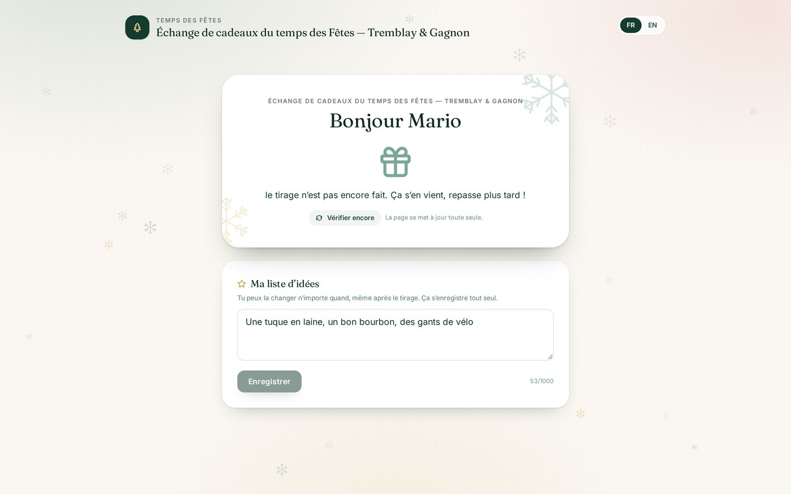<br><b>Before the draw</b> — « pas encore réglé »; it polls, and offers a manual check.</td>
    <td width="50%">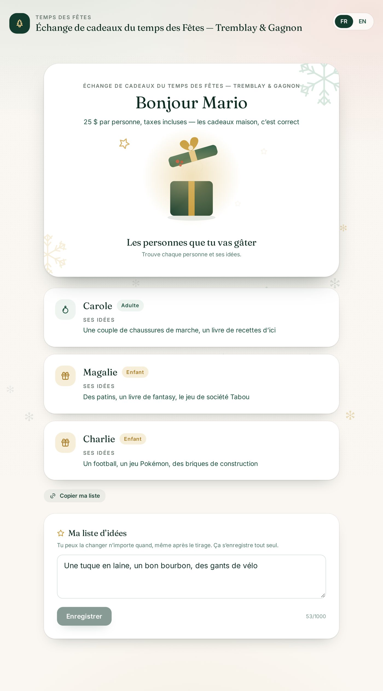<br><b>After the reveal</b> — who you buy for, with their wishlist, plus “copy my list”.</td>
  </tr>
  <tr>
    <td>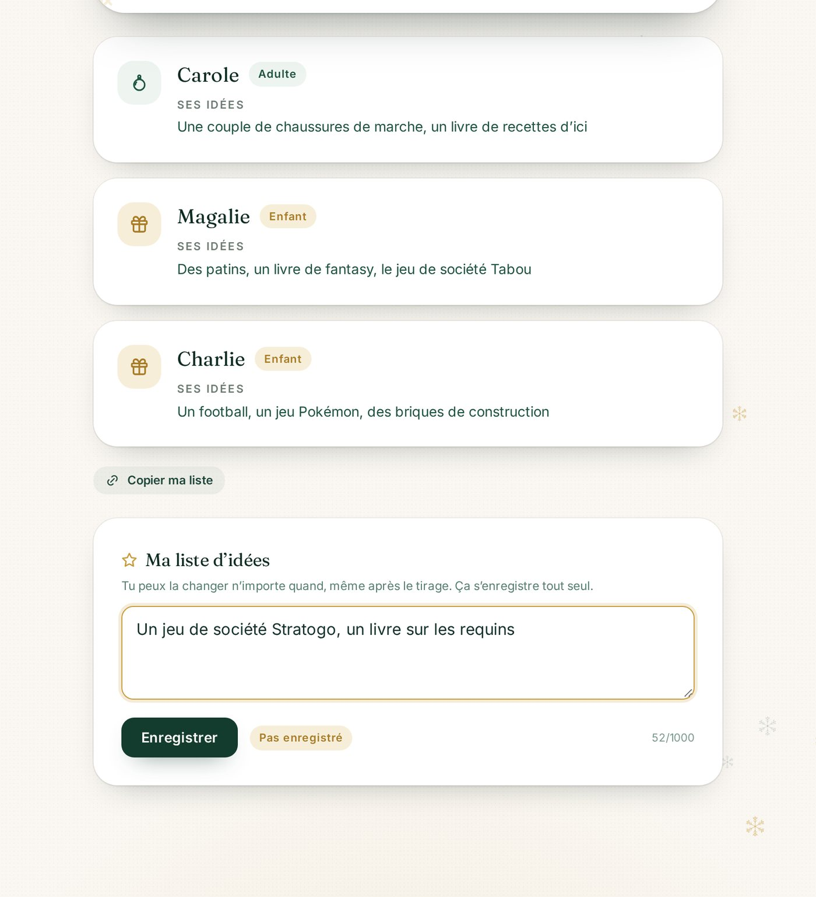<br><b>Autosave</b> — saves 1.2 s after you stop typing; <kbd>Ctrl</kbd>/<kbd>⌘</kbd>+<kbd>Enter</kbd> saves now.</td>
    <td>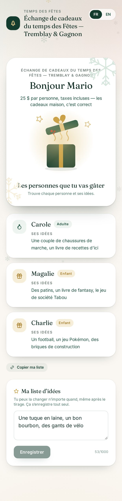<br><b>Phone-first</b> — the whole flow works one-handed, no horizontal scroll.</td>
  </tr>
</table>

UX details worth knowing:

* **The French is ordinary Quebec French** (`fr-CA`), not the caricature of it: « Règles et
  quotas », « Les personnes que tu vas gâter », « Lancer le tirage », « Fermer la session »,
  « Ouvre ton lien », dates like « il y a 5 minutes ». The words people actually use — *piger*,
  *gâter*, *liste d’idées* — and no performed joual (no « pis », no « toé », no « frette »).
  `tests/test_i18n.py` keeps the two languages on the same keys and the same `{placeholders}`,
  refuses the caricature forms, and refuses two different controls that would share one label.
  Amounts are CAD (« 25 $ par personne, taxes incluses »); the EN switch says `$25 CAD`.
* **Nothing destructive without a confirm**, and failures keep their message on screen with a
  translated explanation (« Mot de passe pas correct. », « Trop de demandes. Réessa dans 300
  seconde(s). ») instead of a raw `detail` string.
* **Field limits come from the server** (`GET /api/limits`) and are applied as `maxlength` with
  counters, so the frontend can never drift from the API's Pydantic caps.
* **Reveal is sticky per link** (`sessionStorage`): a refresh does not replay the surprise.

### Sharing the link: what the preview shows

The organizer hands out links, so the link preview is the front door. Every page carries Open
Graph + Twitter card tags — title « Échange de cadeaux · Père Noël secret », the description, and
`static/og-image.png` (1200×630 PNG), plus `favicon.svg`, `apple-touch-icon.png`, `icon-512.png`
and a `site.webmanifest` so "add to home screen" looks intentional on a phone.

Three decisions in it are deliberate:

* **The URL-dependent tags are injected by the server** (`share_meta()` in `main.py`). The same
  image answers on a public domain, a LAN hostname, or `http://192.168.1.10:8085`, and a preview
  has to name the host the browser was actually given. `X-Forwarded-Proto` is trusted only with
  `TRUST_PROXY=1`, otherwise the card would advertise `http://` behind your own TLS proxy — and a
  Host header that isn't a host loses the URL tags rather than echoing garbage.
* **The card is identical for `/` and for a private `/?t=<uuid>`.** Crawlers read this markup, so
  it carries the generic gift card and never a name, an event title, or a token. Asserted in
  `tests/test_share_metadata.py`.
* **The card is square-safe.** Facebook, WhatsApp and iMessage crop the wide image to the centre
  square on phones, so the headline is laid out to live inside the middle 630 px — and
  `tools/build_share_art.py` measures the rendered headline and **fails the build** when it
  doesn't fit.

Regenerate the art (Chromium renders the same HTML/SVG/fonts as the app, so the card matches the
UI instead of drifting from it):

```bash
python3 tools/build_share_art.py   # static/og-image.png, icon-512.png, apple-touch-icon.png
```

## Engine

`generate_draw(config, participants)` builds a balanced receiver pool (`divmod` over each target
group, so nobody receives an unfair number of gifts), then deals slots to givers — most-constrained
first — with depth-first backtracking.

Two layers of rule, and they are deliberately not the same kind of thing:

* **Hard**: no self-draw, no two gifts from one giver to the same receiver, and a giver cannot owe
  more adult/child gifts than the roster contains receivers of that kind. Only these are checked
  up front (`_feasible`), and only these can produce a `422`.
* **Soft**: the same-group exclusion. The search runs with a crossing budget, starting at the
  `_min_crossings()` lower bound and stepping up by one, so it degrades by the smallest amount the
  roster allows instead of failing. The strict pass gets the full attempt budget (`20000` by
  default); a relaxation gets `max_attempts // 10`, so the ladder cannot multiply the worst case.

Returns `(pairs, crossed)` — `crossed` is how many gifts landed inside a group, which is what the
console reports.

## Tests

```bash
bash run_tests.sh          # 90 tests: engine invariants, grouping bounds, API contract, security, previews
```

`run_tests.sh` creates its own virtualenv (`uv` if present) and adds `httpx` + `pytest` there only,
keeping `requirements.txt` pinned to `fastapi==0.115.0` and `uvicorn==0.30.6`. Audit a live
instance (it seeds the spec scenario, draws, then checks the HTTP API **and** the SQLite file):

```bash
ADMIN_PASSWORD=<pw> python3 tools/verify_acceptance.py     # ACCEPTANCE: PASS
```

## Layout

```
gift-exchange/
├── docker-compose.yml            # simple: all interfaces, port 8085
├── docker-compose.hardened.yml   # localhost-only, read-only FS, no capabilities, uid 1000
├── .env.example                  # copy to .env (git-ignored)
├── Dockerfile                    # python:3.12-slim + pinned fastapi/uvicorn
├── main.py                       # API + matching engine + SQLite schema
├── static/index.html             # SPA: organizer console + participant view (FR-CA/EN)
│                                 # + og-image.png, favicon.svg, icons, site.webmanifest
├── docs/                         # screenshots + GIFs used by this README
├── tests/                        # 90 tests
├── tools/                        # seed_demo, verify_acceptance, browser + docs media, share-card build
├── run_tests.sh
├── LICENSE · NOTICE              # MIT + third-party artwork attribution
└── PLAN.md                       # specification, deviations, threat table, verification log
```

Regenerate the gallery (needs Playwright, ffmpeg, Pillow — none of them are app dependencies):

```bash
uv pip install playwright && playwright install chromium
ADMIN_PASSWORD=<pw> python3 tools/seed_demo.py
GE_BASE=http://127.0.0.1:8085 python3 tools/capture_docs_media.py
python3 tools/build_docs_media.py
python3 tools/build_share_art.py            # link-preview card + icons (also Chromium)
```

The console's client-side glue (Alpine getters, the checkbox's `0/1` ↔ boolean coercion, the two
group notices) is invisible to the Python suite, so there is a browser check for it too:

```bash
GE_BASE=http://127.0.0.1:8085 ADMIN_PASSWORD=<pw> python3 tools/check_organizer_ui.py
```

## Notes

* Names, wishlists and events in the screenshots are **fictional demo data** from
  `tools/seed_demo.py`; `data/` is git-ignored and nothing about a real family is in this repo.
  Two of the demo households are deliberately both surnamed Tremblay — that is what the « Groupe »
  column is for.
* Snowfall, the reveal and the burst are CSS/SVG only, disabled under `prefers-reduced-motion`.
* Icons: one inline SVG sprite — a bespoke crystalline snowflake plus Tabler Icons (MIT), see
  [NOTICE](NOTICE).
* Clipboard writes fall back to a hidden textarea on plain-HTTP origins where
  `navigator.clipboard` is blocked.

## Licence

MIT — see [LICENSE](LICENSE) and [NOTICE](NOTICE). Contributions welcome under the same licence.
